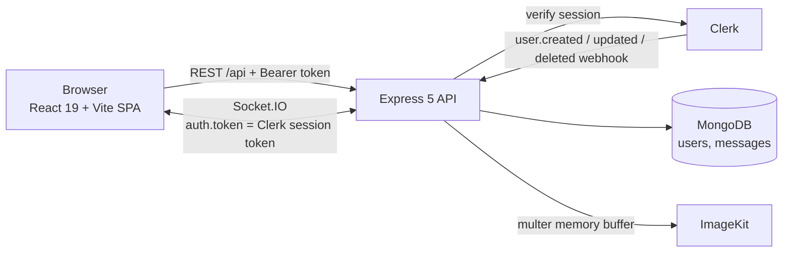

# Nook Chat

A real-time, one-to-one messaging web app: React frontend, Express + Socket.IO backend, MongoDB persistence, Clerk authentication, and ImageKit media uploads.

[](https://github.com/Shree1194/nook-chat/actions/workflows/ci.yml)

**Status:** runs locally; backend security regression tests, lint and production builds pass; **not deployed** (no live URL). Details in [Verification status](#verification-status) and [Limitations](#limitations).

Default branch: `main`.

## Contents

[Features](#features) · [Screenshots](#screenshots) · [Architecture](#architecture) · [Stack](#stack) · [Authentication and authorization](#authentication-and-authorization) · [Local setup](#local-setup) · [Environment variables](#environment-variables) · [Security hardening](#security-hardening) · [Verification status](#verification-status) · [Docker and deployment](#docker-and-deployment) · [Limitations](#limitations) · [Licensing and attribution](#licensing-and-attribution) · [Troubleshooting](#troubleshooting)

## Features

Each item below was checked against the source.

- Sign-in and session handling through Clerk (`@clerk/react` in the browser, `@clerk/express` on the API).
- One-to-one text conversations stored in MongoDB, with a sidebar of existing conversations sorted by most recent message.
- Live message delivery to the recipient over Socket.IO when they are online; messages are always saved first.
- Online presence: the server broadcasts the set of connected user IDs on every connect and disconnect.
- Image and video attachments (up to 25 MB; JPEG, PNG, GIF, WebP, AVIF, MP4, MOV, WebM, checked by file content) uploaded to ImageKit. Requires `IMAGEKIT_PRIVATE_KEY`; without it the API returns `503` for attachments.
- Clerk webhook that creates, updates and deletes the matching MongoDB user profile.
- Interface extras: theme presets, selectable wallpapers, keystroke sounds.

## Screenshots

No screenshots are committed yet, and none are shown here rather than using mock-ups. To add real ones, run the app locally, capture the chat view, and place the images in `docs/screenshots/`.

## Architecture



In production a single Docker image serves the built SPA and the API from one origin, so REST and WebSocket traffic share a host. More detail, including the socket lifecycle and data model, is in [docs/architecture.md](docs/architecture.md).

## Stack

| Layer | Technologies (from `package.json`) |
| --- | --- |
| Frontend | React 19, Vite 8, Tailwind CSS 4, HeroUI 3, Zustand, React Router 7, Axios, socket.io-client |
| Backend | Node 22, Express 5, Socket.IO 4, Mongoose 9, Multer, `@clerk/express`, `@clerk/backend`, `@imagekit/nodejs`, `cron` |
| Infrastructure | Docker (multi-stage), Render Blueprint (`render.yaml`) |

## Authentication and authorization

- **REST:** `protectRoute` reads the Clerk session from the request, loads the matching MongoDB user, and rejects with `401` (no session) or `404` (profile not yet synced by the webhook). Every `/api/messages/*` and `/api/auth/*` route sits behind it.
- **Message scoping:** `getMessages` and the conversation list filter by the authenticated user's ID taken from the session, never from the request body.
- **Recipient checks:** `:id` must be a 24-character hex ID, must belong to an existing user, and cannot be the sender; otherwise the API answers `400` or `404` before any upload or write.
- **Sockets:** the `io.use` middleware verifies the Clerk token sent in the handshake and resolves the user from MongoDB before accepting the connection. Unverified connections are refused.
- **Webhook:** `/api/webhooks/clerk` is mounted with the raw body before `express.json()` and verified with the signing secret; invalid signatures return `400`.

## Security hardening

Fixes made after an audit of the original code, each covered by tests in `backend/test/`:

| Issue found | Fix |
| --- | --- |
| Any signed-in user could list every other user's email and Clerk ID | `/api/messages/users` and `/api/messages/conversations` return only `_id`, `fullName` and `profilePic`; the chat header no longer reads an email |
| Recipient ID was not validated; unknown IDs could create orphan messages and malformed IDs caused `500` | Strict ID format, existing-user and not-self checks run before upload or save |
| Message text could be a non-string (query-operator objects), empty, or unbounded | Text must be a string, trimmed, at most 2000 characters, and a message needs text or an attachment |
| Upload type relied on the client-declared MIME type | The server inspects the file's leading bytes, accepts only the formats listed above, rejects SVG, HTML and type mismatches, and uploads using the detected type |
| Multer errors surfaced as `500` | Oversized files return `413`, rejected types `400` |

Still by design: signed-in users can see other users' display names and avatars so they can start a conversation. There is no per-user rate limiting or malware scanning of uploads.

## Local setup

Requirements: Node.js 22+, a MongoDB instance (local or Atlas), a Clerk development application.

```bash
# backend
cd backend
npm ci
cp .env.example .env      # PowerShell: Copy-Item .env.example .env
npm run dev               # http://localhost:3001

# frontend (second terminal)
cd frontend
npm ci
cp .env.example .env
npm run dev               # http://localhost:5173 (proxies /api and /socket.io)
```

Create a Clerk webhook for `user.created`, `user.updated` and `user.deleted` pointing at `/api/webhooks/clerk` (use a tunnel for local development) and put its signing secret in `CLERK_WEBHOOK_SIGNING_SECRET`. Until the webhook has synced a user, that user gets `404 User profile is not synced yet`. `npm run db:seed` in `backend/` runs the seed script.

## Environment variables

Both `.env.example` files contain placeholders only; real `.env` files are git-ignored (`.gitignore` covers `.env`, `.env.*` and `**/.env*`, and no `.env` file is tracked).

| Variable | File | Purpose |
| --- | --- | --- |
| `VITE_CLERK_PUBLISHABLE_KEY` | `frontend/.env` | Clerk publishable (public) key |
| `CLERK_PUBLISHABLE_KEY`, `CLERK_SECRET_KEY` | `backend/.env` | Clerk backend configuration; the secret must stay private |
| `CLERK_WEBHOOK_SIGNING_SECRET` | `backend/.env` | Verifies webhook payloads |
| `MONGO_URI` | `backend/.env` | MongoDB connection string |
| `FRONTEND_URL` | `backend/.env` | Allowed CORS and Socket.IO origin(s), comma-separated; also used by the keep-alive job |
| `PORT`, `NODE_ENV` | `backend/.env` | Port (default 3001) and environment |
| `IMAGEKIT_PRIVATE_KEY` | `backend/.env` | Optional; enables attachments |
| `VITE_API_URL`, `VITE_DEV_PROXY_TARGET` | `frontend/.env` | Optional API base URL and dev proxy target |

## Verification status

Run on 2026-10-16 in a clean Linux environment with Node 22.22. These are local results; they are separate from CI and from any live deployment.

| Check | Result |
| --- | --- |
| `cd backend && npm ci && npm run build` | Passed |
| `cd backend && npm test` | **Passed: 27 of 27** (REST authorization, recipient validation, profile privacy, upload validation, Socket.IO handshake) |
| Same tests against the pre-fix controller and route | 14 of 27 failed, confirming the tests detect the original issues |
| `cd frontend && npm ci --legacy-peer-deps && npm run lint` | Passed (no findings) |
| `cd frontend && npm run build` | Passed; Vite warns that the main chunk is about 699 kB |
| End-to-end run (real Clerk, MongoDB, ImageKit) | **Not performed**; requires real credentials |
| Docker image build | **Not run** |
| Frontend tests | **None exist** |

The tests replace Clerk, MongoDB, ImageKit and Socket.IO delivery with in-memory fakes, so they verify this repository's routing, validation and authorization logic, not the third-party services. They use Node's built-in test runner with `--experimental-test-module-mocks` (Node 22.3 or newer). `.github/workflows/ci.yml` runs the backend build and tests plus frontend lint and build on every push and pull request; the badge above shows its latest real result.

## Docker and deployment

```bash
docker build --build-arg VITE_CLERK_PUBLISHABLE_KEY=pk_test_xxx -t nook-chat .
docker run -p 10000:10000 --env-file backend/.env nook-chat
```

The image builds the SPA and the API, then runs `node dist/index.js` as the unprivileged `node` user with the SPA served from `public/`. [`render.yaml`](render.yaml) describes a Render web service (Docker, `/health` check, free plan).

**Deployment status: pending.** No live URL exists; the app has not been deployed to Render or elsewhere. The free tier may sleep when idle, which is why a keep-alive job pings `/health` every 14 minutes in production.

## Limitations

- **Not deployed.** No live URL exists. `render.yaml` is untested against a real Render account.
- No frontend tests, no browser end-to-end tests, and the mocked backend tests do not exercise the real Clerk, MongoDB or ImageKit services.
- No rate limiting on message sending or uploads, and no malware scanning of attachments.
- Any signed-in user can list other users' display names and avatars.
- Socket state is an in-memory map of one socket per user, so a second tab replaces the first, and the server cannot scale beyond a single instance without an adapter.
- No message editing, deletion, read receipts, typing indicators, group chats, or pagination of history; the `messages` collection has no explicit indexes.
- The Dockerfile `EXPOSE`s 3001 while the image defaults to port 10000.
- **No project license is granted yet** because the origin of the bundled wallpapers and sounds is unconfirmed. See [Licensing and attribution](#licensing-and-attribution).

## Licensing and attribution

Nook's backend follows the structure of the MIT-licensed [fullstack-chat-app](https://github.com/burakorkmez/fullstack-chat-app) tutorial project by Burak. This repository replaces its JWT/bcrypt login with Clerk, Cloudinary with ImageKit, and daisyUI with HeroUI, and adds the Clerk webhook sync, server-verified Socket.IO handshake, input validation, content-based upload checks, tests, Docker and CI. The original MIT notice is kept in [THIRD_PARTY_NOTICES.md](THIRD_PARTY_NOTICES.md).

The wallpapers and keystroke sounds in `frontend/public/` have unconfirmed sources, so they are not licensed here. Until they are confirmed or replaced, this repository has no `LICENSE` file and the code should be treated as all rights reserved by its author, other than the MIT-licensed portions noted above.

## Troubleshooting

- **`/health` returns 503:** MongoDB is not connected; check `MONGO_URI`.
- **`404 User profile is not synced yet`:** the Clerk webhook has not created the user; check the webhook URL and `CLERK_WEBHOOK_SIGNING_SECRET`.
- **Socket connection refused:** the token was rejected or the profile is unsynced; also check that `FRONTEND_URL` includes the browser's origin.
- **`503` when sending an attachment:** `IMAGEKIT_PRIVATE_KEY` is not set.
- **`npm ci` peer-dependency errors in `frontend/`:** use `--legacy-peer-deps`, as the Dockerfile does.
