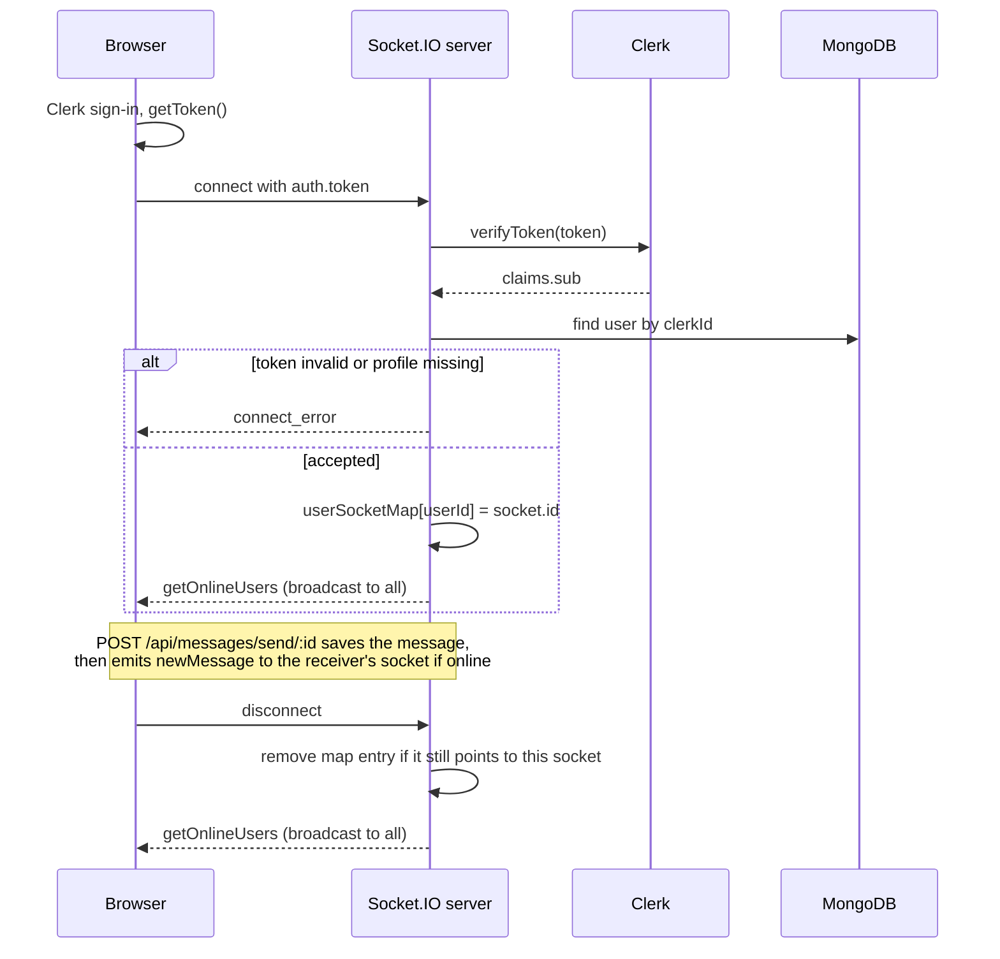

# Nook Chat architecture notes

Derived from `backend/src` at commit `7148b82`. Back to the [README](../README.md).

## Socket.IO connection lifecycle

Only two server events exist: `getOnlineUsers` (broadcast) and `newMessage` (to one socket). Sending goes through the REST endpoint, not through a socket event.

## Data model

| Collection | Fields | Notes |
| --- | --- | --- |
| `users` | `clerkId` (unique), `email` (unique), `fullName`, `profilePic`, timestamps | Created and updated by the Clerk webhook; deleted on `user.deleted` |
| `messages` | `senderId`, `receiverId` (ObjectId refs to `users`), `text`, `image`, `video`, timestamps | A conversation is the set of messages between two users; there is no separate conversation document |

The sidebar conversation list is an aggregation over `messages`: it matches messages involving the caller, groups by the other participant, sorts by latest message time, joins the user profile, and projects only `_id`, `fullName` and `profilePic`. There are no explicit indexes beyond the unique fields, so large histories would need indexes on `senderId`, `receiverId` and `createdAt`.

## Media upload path

1. Browser posts `multipart/form-data` (field `media`) to `POST /api/messages/send/:id`.
2. `multer` keeps the file in memory, enforces 25 MB, and accepts only `image/*` or `video/*` declared types. The controller then checks the file's leading bytes (`src/lib/fileType.js`): the content must be a supported image or video format and match the declared category.
3. The recipient is validated first. The controller returns `503` if `IMAGEKIT_PRIVATE_KEY` is missing; otherwise the buffer is uploaded to ImageKit folder `/chat` with a sanitized, timestamped filename.
4. The returned URL is stored in `image` or `video` on the message.

## Authorization summary

| Surface | Requirement | Failure |
| --- | --- | --- |
| `/health` | none | `503` until MongoDB is connected |
| `/api/auth/check` | valid Clerk session and synced profile | `401` / `404` |
| `/api/messages/*` | valid Clerk session and synced profile; recipient ID must be well-formed, existing and not the sender | `401` / `404` / `400` |
| Socket handshake | valid Clerk token and synced profile | `connect_error` |
| `/api/webhooks/clerk` | valid signature | `400` |

## Tests

`backend/test/` holds 27 tests run with `npm test` in `backend/` (see the README for the exact results and what they do not cover). `messages.test.js` runs the real routes, middleware and controllers over HTTP with fake Clerk, MongoDB, ImageKit and socket-delivery modules; `socket.test.js` starts the real Socket.IO server and connects real clients with valid, forged, missing and unsynced tokens; `fileType.test.js` covers the file signature checks.

Not yet covered: the Clerk webhook handler (signature rejection and user upsert), the conversation aggregation against a real database, and multi-tab socket behavior.
